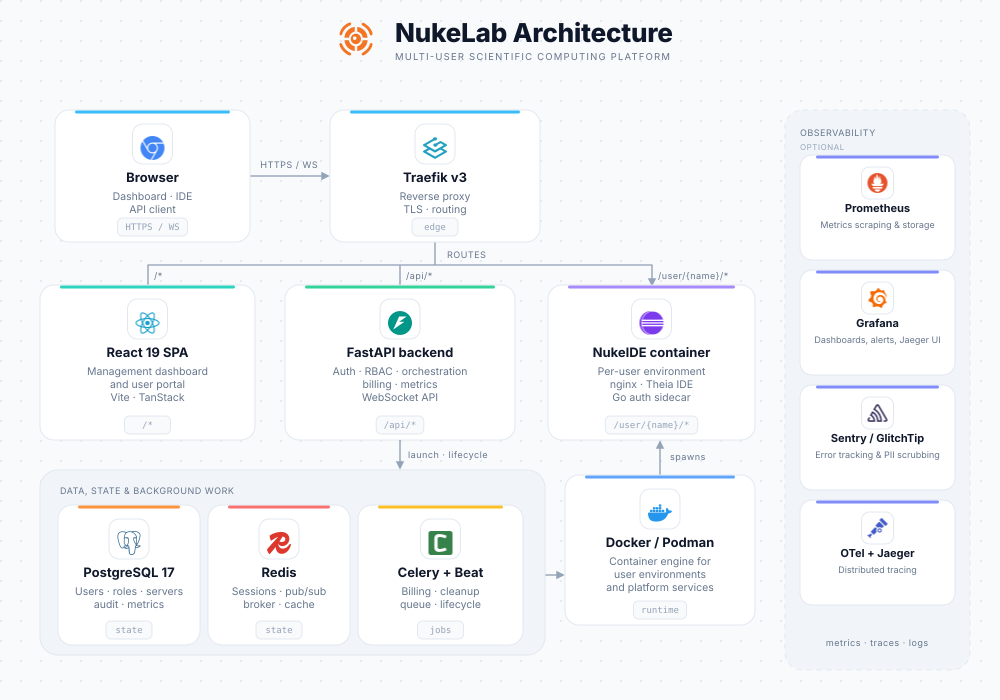

# NukeLab

[](https://github.com/nukehub-dev/nukelab/actions/workflows/ci.yml)
[](https://github.com/nukehub-dev/nukelab/actions/workflows/security.yml)

NukeLab is a self-hosted platform for teams that share scientific computing
infrastructure. Researchers launch browser-accessible workspaces from approved
environments, and operators control access and allocate CPU, memory, storage,
and GPUs.

[Quick start](#quick-start) · [Documentation](docs/README.md) · [Roadmap](docs/plan/ROADMAP.md) · [Changelog](CHANGELOG.md)

## What you can do

- **Share compute.** Set resource plans, allocate GPUs, manage access by role, and queue launches when capacity is full. NUKE credits track and limit usage.
- **Recreate workspaces.** Save launch provenance and match registry-verified environment revisions by image digest and configuration across installations.
- **Recover data and interrupted work.** Back up offline private volumes, restore into new volumes, and give operators evidence to reconcile interrupted launches and recovery operations.
- **Operate the platform.** Monitor live resource usage, review audit logs, and inspect published image provenance and SBOM attestations.

## Quick Start

For a local evaluation, install Git and either Docker with Compose or Podman
with a Compose provider.

```bash
git clone https://github.com/nukehub-dev/nukelab.git
cd nukelab
cp .env.example .env.development
./nukelabctl start
```

Open <http://localhost:8080> and sign in with the default development credentials
`admin` / `admin123`. Open **Administration → Setup** to publish an active public
environment and confirm that a plan is available to users before the first launch.
[First-run catalog setup](docs/operations/OPERATIONS.md#9-first-run-catalog-setup)

For hot reload, install Node.js 24+ and npm, then run
`./nukelabctl install frontend` followed by `./nukelabctl dev`.
[Local development guide](docs/development/LOCAL-DEV.md)

## Architecture at a Glance

<picture>
  <source media="(prefers-color-scheme: dark)" srcset="docs/assets/architecture-dark.svg">
  <source media="(prefers-color-scheme: light)" srcset="docs/assets/architecture-light.svg">
  
</picture>

Traefik routes traffic to the React frontend, FastAPI backend, and NukeIDE
workspaces on Docker or Podman. PostgreSQL stores platform state, Redis handles
caching and messaging, and Celery runs background work.
[System overview](docs/architecture/OVERVIEW.md) · [Component responsibilities](docs/architecture/COMPONENTS.md)

## Documentation

| I want to | Start here |
| --- | --- |
| Deploy and operate NukeLab | [Production deployment](docs/operations/PRODUCTION-DEPLOYMENT.md) · [Operations guide](docs/operations/OPERATIONS.md) |
| Back up the database or private volumes | [Backup and restore](docs/operations/BACKUP-RESTORE.md) |
| Understand access and workspace behavior | [Authentication and authorization](docs/architecture/AUTH.md) · [Server lifecycle](docs/architecture/SERVER-LIFECYCLE.md) |
| Configure the platform | [Environment variables](docs/reference/ENV-VARS.md) · [CLI reference](docs/reference/CLI-COMMANDS.md) |
| Develop or contribute | [Local development](docs/development/LOCAL-DEV.md) · [Contributing guide](docs/development/CONTRIBUTING.md) |

## Management Commands

```bash
./nukelabctl status         # Show running services
./nukelabctl logs backend   # Follow backend logs
./nukelabctl stop           # Stop the stack
```

## API

When API documentation is enabled, the running stack serves
[interactive API docs](http://localhost:8080/api/docs) and the
[OpenAPI schema](http://localhost:8080/api/openapi.json).

## License

[BSD-2-Clause](LICENSE)
